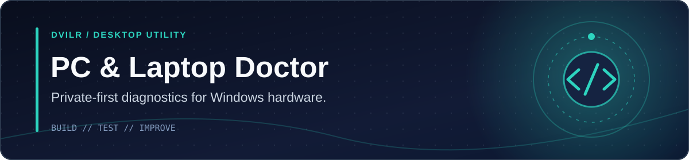

<!-- DVILR PROJECT COVER v1 -->
<p align="center"></p>
<p align="center"><a href="https://github.com/dvilrgamerz"><strong>Developer profile</strong></a> · <a href="https://github.com/dvilrgamerz/PC-Laptop-Doctor-AI"><strong>Source</strong></a></p>
<!-- /DVILR PROJECT COVER -->

# PC & Laptop Doctor AI

**Local-first Windows PC diagnosis, Boost & Play, installed game discovery, opt-in hands-off Game Focus, recurring recoverable Temp care and evidence-based performance comparisons. Free and open source.**

## Download V7.5 Space Finder + GPU Monitor — public beta (Windows x64)

[**Get PC Laptop Doctor AI for Windows — GitHub Releases**](https://github.com/dvilrgamerz/PC-Laptop-Doctor-AI/releases/tag/v7.5.0-beta.6)

Two 64-bit Windows editions are produced by the verified build pipeline:

| Edition | File | What it does |
| --- | --- | --- |
| Guided setup | PC-Laptop-Doctor-AI-Setup-7.5.0-beta.6-x64.exe | NSIS setup wizard; choose an installation directory; Start menu/desktop shortcuts; uninstall via Windows |
| Portable | PC-Laptop-Doctor-AI-Portable-7.5.0-beta.6-x64.exe | Run without installing |

## New in V7.5 — find real storage pressure and add GPU monitoring

- **Large Downloads Space Finder:** The Windows app can list the 60 largest qualifying top-level Downloads files over 100 MiB, without reading their content, entering subfolders, or uploading file names. It never deletes Downloads automatically.
- **Approve and recycle selected files:** Review specific filenames, confirm a single Recycle Bin operation, and PC Doctor safely moves up to 20 selected files (20 GiB max). Each file is rechecked for size, timestamp, type and identity before moving; changed files are skipped. It does **not** permanently delete downloads or empty Recycle Bin.
- **GPU usage when available:** Adds an optional GPU load card to the existing live CPU/RAM/storage/temperature/network monitor. Unknown GPU readings are shown as unavailable; high GPU load during a game is not inherently a fault.
- **Low-storage shortcut:** The live storage warning jumps directly to Space Finder. The existing approved old Temp cleanup and opt-in weekly Autopilot are preserved.
- **Simple interface:** Primary Boost & Play view is oriented around live resource pressure, automatic game focus, recoverable cleanup and straightforward file review rather than hundreds of ambiguous tweak buttons.

**Important:** Moving files to Recycle Bin does *not* reclaim SSD capacity until Recycle Bin is emptied. Only uninstalling unused apps, clearing supported temporary files, or deliberately removing unneeded large data will recover significant storage space. The tool does not guess which personal files are expendable.

**Release status:** Public **beta**, unsigned Windows x64. Automated tests and Windows packaging validate the code and the executables—not actual performance gains on the user's machine or independent security certification. Broad testing is still required before promoting to stable.

## New in V7.4 — Live PC Monitor and simpler Autopilot

- **Current CPU / RAM / storage / CPU temperature / network throughput:** A new main-screen read-only monitor refreshes approximately every eight seconds, keeps short on-screen trends and flags capacity pressures. Unknown temperature or network data is displayed as unavailable, never as a safe reading.
- **Actual bottlenecks first:** When your primary drive is at 95% capacity or has under 10 GiB free, a prominent warning directs you to safe cleanup and storage review. RAM above 90% and CPU near 95% are also called out.
- **Simpler automatic setup:** Select **Prepare safe automatic care** to propose both game Autopilot and weekly recoverable Temp care. You still approve and save the settings explicitly. Both remain off by default on first installation.
- **Privacy/efficiency:** Live readings are collected locally on demand, cached to prevent excessive polling, and kept in memory only while the panel is open. No remote telemetry or automatic process termination.

Read [the V7.4 feature audit and friend-testing checklist](docs/V7_4_MONITOR.md).

**No false promises:** The updated monitor does not prove FPS improvements, fix hardware failures or replace manual review of important Windows files. The user-Temp cleaner is narrowly scoped; moving files to Recycle Bin does not immediately reclaim disk space. The executable remains unsigned and should be treated as a public **beta**, not certified stable software.

## V7.3 — Hands-off Autopilot with strict safety limits

- **Auto Game Focus:** Off by default. After one explicit opt-in, PC Doctor checks only the full process executable paths of games you personally added through its trusted-file picker. Two consecutive detections start a temporary Standard Game Mode session; three consecutive misses restore previous supported Windows preferences. It will not match a random process by name alone, force-close apps, alter a game, or bypass anti-cheat. Exact process paths may be unavailable; unsupported games are skipped.
- **Timed safety fallback:** An automatic session has a two-hour maximum. The process watcher runs only while PC Doctor is open. Steam/Epic titles outside detectable installed-game folders, unreadable paths, and unsupported launchers can still use explicit Boost & Play or trusted EXE selection. Restart recovery remains available.
- **Weekly Safe Temp Care:** Separate opt-in. While PC Doctor is running, once per seven days it moves only top-level user Temp .tmp files older than 30 days into Windows Recycle Bin. Files younger than 30 days, log files, folders, personal files and game installations are excluded. It skips known active custom-game sessions and has the existing caps of 300 files and 1 GiB. No permanent unattended deletion is performed.
- **Faster start and clear priorities:** The app opens on Boost & Play, performs a read-only scan automatically, and brings high RAM utilization or nearly full storage to the top of the screen. Settings and storage maintenance remain user-controlled.
- **Performance claims:** Running Windows Game Mode is not a guarantee of improved FPS. Recycling files is recoverable but does not free disk space until Recycle Bin is emptied. An additional manually approved irreversible .tmp cleanup remains available as an advanced feature.

**Release assessment:** This is an unsigned public beta for willing Windows testers, not a certified stable Razer Cortex/Hone replacement. Real physical-device Windows tests, code signing, performance comparisons and an independent security audit are still required. Do not disable Windows protections to install it.

See [Autopilot design and limitations](docs/V7_3_AUTOPILOT.md) and [friend testing checklist](docs/FRIEND_TESTING.md).

### Three steps to start

1. Install Windows Setup or run Portable. It opens on Boost & Play and starts a read-only system diagnosis automatically. Keep Windows security protections enabled.
2. Click **Run Full Diagnosis**, then open **Boost & Play**. Steam and Epic titles are discovered automatically; other trusted installed games can be added once using the file picker.
3. Choose a game and **Boost & Play**. Or opt in once to **Autopilot** for automatic Game Focus when an exact trusted, user-added game executable starts. Separately opt in to weekly recoverable cleanup of old Temp .tmp files. You can disable both switches at any time.

Game Focus uses supported Windows Game Mode and optional standard High performance on AC power. It does **not** close background apps, edit game files, or guarantee FPS gains. The recoverable automatic cleaner moves stale top-level user Temp `.tmp`/`.log` files to Recycle Bin; space is not reclaimed until you empty the bin. An optional **irreversible** advanced action deletes only older `.tmp` candidates to reclaim some space.

**[Testing guide for friends](docs/FRIEND_TESTING.md)** · **[Submit a bug report](https://github.com/dvilrgamerz/PC-Laptop-Doctor-AI/issues/new?template=bug_report.yml)** · **[V7 feature/status details](docs/V7_RELEASE.md)**

### Setup steps

1. Open **Releases** in the GitHub repository and select the latest release.
2. Under **Assets**, download the Setup.exe (recommended) or Portable.exe.
3. Start the installer, select the installation scope and location, and complete the wizard.
4. Launch the application from Start, the desktop, or directly via the portable file.
5. Press **Run Full Diagnosis** to inspect your computer. Use the new sidebar to review hardware details.
6. Export a privacy-conscious JSON report, if needed. Redacted summaries can still contain identifiable hardware characteristics.

### Safety and publisher verification

**V7 is an unsigned public beta, not yet a verified stable release.** Windows may display an unknown-publisher SmartScreen warning. Download only from this repository's own release assets, optionally compare the executable's SHA-256 to the release's **SHA256SUMS.txt**, and independently review the source. Never disable security protections for unfamiliar files.

The installer may request Windows elevation if you select a system-wide installation. Routine diagnostics do not need admin permissions. The scan is read-only. Optional Fix & Gaming controls can change Windows Game Mode, the active power plan, flush the Windows DNS resolver cache, or clear only PC Doctor's own Electron HTTP cache after a separate explicit confirmation. Previous Game Mode and power-plan values are saved locally and can be restored. Cache clearing has no undo and is described separately. The application never deletes personal files, kills processes, downloads AI models automatically, alters third-party game/anti-cheat files, or applies hidden optimizations. Optional read-only Steam detection inspects application manifests from known library locations.

The built-in diagnostics engine uses **explicit thresholds**. The optional LLM panel can query a separately installed Ollama model on localhost after approval; the app does not train or ship an AI model. Temperature readings, capacity estimates and hardware information may be unavailable on some devices. The health score is a guide, not a guarantee that a computer is fault-free.

### Build locally

Requires Node.js 22+ and npm. On Windows x64:

~~~powershell
npm install
npm test
npm run dist:win
~~~

The generated setup and portable executables are written to **release/**. For development, run **npm run dev**. GitHub Actions also builds the two executables on Windows and publishes a versioned prerelease when merged code passes the pipeline.


## V7.3 — Automatic Game Focus restoration and easier cleanup

- **New: timer-based recovery.** The Game Focus session can restore managed Windows Game Mode and the optional High performance power plan automatically after 30, 60, 120 (default) or 240 minutes. It also attempts restoration on normal exit and at next start after interruption.
- **New: automatic read-only preview.** Opening Boost & Play starts local game discovery and safe Temp candidate scanning without making any changes.
- After you approve, Boost & Play runs supported temporary settings and asks the selected game launcher to start; no manual Windows Settings navigation. Steam and Epic detection, plus one-time custom executable selection, remain supported.
- A single approved Auto Clean action sends eligible old Temp files to Recycle Bin. Advanced permanent cleanup is narrowly bounded and separately approved. **A Recycle Bin move does not actually reclaim disk space.**
- **Not automatic:** game-exit detection, every launcher, closing background processes, a universal FPS improvement, and forced deletion of unknown files.

This is a **public beta** for friends, not a signed production release. Game Focus timers do not close games and are not performance guarantees.

## V7.1 — More automatic game and storage workflows

- **Boost & Play:** Choose an installed Steam or Epic game. Review the short Game Focus preview, approve once, and PC Doctor starts supported reversible Windows preferences and opens the selected game through its launcher. If launch fails, it attempts to restore the changed settings. Stop & Restore, or close PC Doctor normally, after playing.
- **Automatic Steam and Epic detection:** Uses read-only installed-game manifests; launch IDs are checked again before use. This automatically discovers Steam/Epic. For Xbox, Riot, Battle.net, GOG, Ubisoft and standalone EXE titles, use the native Add Game picker once to select a trusted installed game executable. Stored paths remain local and are not shown in the game list.
- **Auto-clean safely:** Review a preview and approve moving all eligible top-level user Temp .tmp/.log files older than 14 days to Windows Recycle Bin. No manual file selection necessary, although advanced manual selection remains available. Recycle Bin moves do not immediately free space.
- **Actually reclaim limited space:** A separate clearly labeled irreversible option permanently removes only top-level .tmp files older than 30 days, capped at 300 candidates and 1 GiB in total, skipping changed or locked files. It never targets Downloads, documents, system folders, game saves or subdirectories. The user must explicitly approve permanent removal.
- **Simpler main screen:** Boost, detect games and cleanup are foregrounded. Advanced tuning remains secondary.

**Public beta status:** Not a certified stable gaming optimizer or proven superior to Razer Cortex/Hone.gg. Windows installer CI is necessary but not physical-device proof. These unsigned executables can trigger a Windows security warning. Do not disable security tools to run software you cannot independently verify.

## Project overview

**Your local-first AI mechanic for Windows PCs and laptops.**

PC Doctor AI scans your computer, turns confusing system data into a simple health score, and explains the problems that deserve attention first.

## Diagnostic features

- Live CPU load and processor details
- RAM usage and memory-pressure detection
- Drive usage and low-storage warnings
- CPU temperature checks when sensors are available
- GPU detection
- Laptop battery, charging state, and estimated battery wear
- Windows startup-app detection
- Network interface and latency check
- System uptime and Windows information
- 0–100 health score
- Prioritized diagnostic report with plain-English recommendations
- Local-first architecture: diagnostic data stays on the computer
- Read-only diagnosis; optional explicitly approved gaming adjustments are separate from the scan

## 🎬 The demo

**Click “Run Full Diagnosis” → watch the system scan → get a health score → see exactly what needs attention.**

This is designed to make PC troubleshooting understandable even if you do not know what CPU load, memory pressure, thermal throttling, or battery wear mean.

## 🚀 Run it

Requirements:

- Windows 10/11 recommended
- Node.js 22+ recommended
- npm

```bash
git clone https://github.com/dvilrgamerz/PC-Laptop-Doctor-AI.git
cd PC-Laptop-Doctor-AI
npm install
npm run dev
```

The Vite dashboard opens inside Electron, where the secure preload bridge gives the UI access to read-only diagnostics.

## 🧠 How V1 works

The desktop process gathers hardware and operating-system information with `systeminformation` and a small read-only PowerShell query for Windows startup entries.

The local diagnostic engine then checks thresholds for:

- excessive CPU load
- memory pressure
- high temperatures
- low disk space
- battery degradation
- too many startup programs
- long uptime
- high network latency

Those signals are converted into the health score and prioritized Doctor Report.

## 🔐 Safety & privacy

V1 is intentionally read-only.

- No registry edits during diagnostics (opt-in Game Mode changes one documented HKCU value)
- No automatic process killing
- No automatic file deletion
- No hidden system changes; explicit consent and Restore controls for optional adjustments
- No cloud account required
- No telemetry included

V1.2 Fix & Gaming actions describe each proposed change and require confirmation. Undo data is saved locally. If the power plan or Game Mode changes outside the app, the app declines to overwrite it.

## V7 — Simpler Game Boost & Cleanup

- **Beginner-first dashboard:** clear shortcuts to Scan, Game Boost & Cleanup, and FPS comparisons, with a new prominent sidebar entry.
- **Session-based Game Focus:** Standard and Plugged-in profiles preview current Windows preference eligibility, require a one-time confirmation, and apply Game Mode and optionally High performance when supported. Existing saved preferences are never overwritten. Normal app exit and subsequent startup attempt guarded restoration.
- **Steam launcher:** detect installed Steam games from local manifests and launch only a verified app ID through Steam. Other launchers not yet supported.
- **Safe storage cleanup:** inspect only old *top-level* user Temp `.tmp` / `.log` files, show name/age/size and let the user select individual files. Revalidate each file before moving it to Recycle Bin; no permanent deletion, system-folder traversal or automatic cleanup. Recycle Bin uses disk space until emptied.
- **Public test guide:** detailed beta checklist, privacy-oriented bug report template and feature/limitation comparison with Razer Cortex and Hone.

**Release status:** Public Windows beta for testers, **not** proven superior to Razer Cortex or Hone; lacks signed executables, real-device compatibility matrix, native game FPS capture, automatic supported-game configuration packs, and independent security audit. [Full V7 release audit](docs/V7_RELEASE.md).

## Version 6.4 — Gaming Optimization & Evidence Studio (preview)

**V6.0:** Four additional actual user-approved Windows preference changes: background captures, Game DVR, desktop transparency, and taskbar animation. Each includes current-value inspection, before/after preview, 60-second one-time confirmation, durable previous-value recovery journal, verification and Restore. The previous Game Mode and power plan controls are retained. Cosmetic adjustments are **not** claimed to raise FPS.

**V6.1:** Real Windows setting status, per-setting risk/measure/official docs, and four conservative advisory profiles. Retains V5.1's 23 guidance options and five earlier manual presets. Neither profile automatically changes settings.

**V6.2:** Read-only Steam game library discovery and manually started game-session resource monitoring. Detects local Steam app manifests; it does not edit game configurations, launch games, kill processes, bypass anti-cheat or promise game-specific FPS boosts.

**V6.3:** A user-approved local gateway vs upstream ping comparison; plus a repeated benchmark lab accepting 3–8 real external frame-time CSV captures per condition. Calculates average FPS, 1% lows, P95 frame times, variability and approximate within-run bootstrap intervals. Captures must be comparable. PC Doctor does **not** record FPS itself.

**V6.4:** Responsive interface enhancements, tests, Windows Setup/Portable builds, unsigned prerelease and SHA-256 checksum file.

**[Detailed implementation/competitor comparison](docs/V6_IMPLEMENTATION.md)** · **[Testing instructions](docs/TESTING.md)** · **[V6 tracking task #10](https://github.com/dvilrgamerz/PC-Laptop-Doctor-AI/issues/10)**

**Honest limitations:** This is not yet full Hone feature parity. The app does not contain per-game executable optimizers, secure auto-updaters, code signing, native GPU benchmarking, direct frame capture, or independent cross-PC FPS improvements. Real Windows performance/rollback verification is still required. Do not download this release to "guarantee FPS": benchmark before and after every change.

## Version 5.1 — Optimization Studio

Added a new **Optimization Studio** tab inspired by studying the scope of Windows gaming optimizers such as Hone.gg, but with an evidence-first workflow:

- **23 curated options**, grouped into Gaming, Windows, Storage and Network categories, with search and saved favorites.
- **5 user-selectable guidance profiles** (Balanced gaming, Competitive FPS, Low-memory PC, Visual quality and Gaming + streaming). Presets **do not silently change settings**.
- Scan-aware recommendations put full drives and high RAM/CPU use ahead of speculative FPS tweaks.
- Each option explains **what it changes, risk, undo path, and links to vendor documentation**. Supported native Windows settings open directly.
- Existing actual Game Mode/power settings remain opt-in and reversible. DNS and app-cache maintenance remain explicitly confirmed and are not claimed to improve FPS.
- No paywall or artificial limit on the number of reviewed options in the open-source UI.
- **User-approved network quality check:** sends 8 ICMP packets to fixed public address 1.1.1.1 and reports average/min/max response and packet loss when Windows output provides trustworthy values. Requires explicit approval and Windows desktop app. This is not your in-game server ping, an internet speed test, or a true jitter benchmark.

**Competitive feature and safety research:** [docs/COMPETITIVE_RESEARCH.md](docs/COMPETITIVE_RESEARCH.md). **Development tasks:** [Issue #7](https://github.com/dvilrgamerz/PC-Laptop-Doctor-AI/issues/7) (research and benchmarks), [Issue #8](https://github.com/dvilrgamerz/PC-Laptop-Doctor-AI/issues/8) (Windows validation and signing).

**Not implemented:** automatic optimization of every game, service-killing game boost modes, frame-time proof of superiority, code-signed binaries, OEM-certified upgrades. See the roadmap for honest status.

## Version 5.0 — Advanced PC Doctor Suite

**Roadmap summary:** User-facing V1–V5 capabilities exist, but **some are partial or experimental**. The code is not an independently verified hardware repair product. See [full roadmap and acceptance criteria](docs/ROADMAP.md).

| Stage | Working features | Not yet verified or fully automated |
| --- | --- | --- |
| V1 Diagnose | Read-only machine scan, health-score heuristics, system summary, battery/network/storage | Diagnosis of every possible hardware fault |
| V2 Safe Repair | Windows cleanup/settings guides, explicit Game Mode/power changes and Restore, approval-gated DNS flush and PC Doctor HTTP-cache clearing, local audit | Arbitrary file cleanup, guaranteed network repair, automatic restore points |
| V3 AI Doctor | Rule-based offline explanation; **optional** installed local Ollama model with limited, redacted metrics and explicit question approval | Bundled or user-trained model, certified root-cause diagnosis |
| V4 Hardware Advisor | Workload-based upgrade advice and on-device system/model, memory-module and drive inspection without serials | Guaranteed free RAM slots, maximum RAM, pricing and OEM-certified compatibility |
| V5 Performance | Opt-in local history, fixed JS CPU check, short temporary-file disk check, game FPS CSV analysis, 1% low and frame-time comparisons | Direct game capture, validated GPU stress test, scientifically controlled performance certification |

### New in V5

**Ask Doctor → Optional local model.** The built-in rules keep working with no model. To enable open-ended text generation, install [Ollama](https://ollama.com/) yourself on Windows, download a model suitable for your hardware and start its local service. Select **Check installed models**, enter a question, and approve sharing the question plus **numeric-only diagnostic metrics** to `127.0.0.1:11434`. No account, external AI API, automatic model download, shell command execution, or telemetry is added by PC Doctor. Model output may be wrong.

**Upgrade Advisor → Inspect hardware.** Reports machine manufacturer/model, board, BIOS version, detected memory modules (capacity/type/speed), physical drives, and optionally the top memory-consuming processes. Omits serials and UUIDs. The detected module count is **not** an authoritative count of physical slots, and compatibility requires the manufacturer's service manual.

**Fix & Gaming → Safe maintenance.** Two approved tasks: flush Windows DNS resolver cache using `ipconfig /flushdns`; clear this app's own HTTP cache using Electron's session API. Both are previewed before they can run, require a single-use confirmation token, and log only action type/date/success locally. Windows may deny DNS flush without permissions. Neither operation guarantees a faster PC or games. They cannot be undone; Game Mode/power plan changes from V1.2 retain their Restore buttons.

**History & Bench → Disk check and FPS CSV lab.** Temporary-file check uses a small bounded file and removes it afterward. Disk reads may come from RAM cache; speed is **not** an SSD specification. To compare actual gaming results, import two CSV recordings collected **by another tool** using an FPS, frame-time-ms or `msBetweenPresents` column. The analysis computes average FPS, a slowest-frame-time **1% low** definition and 95th-percentile frame time. Files are processed locally in the page. It does not capture FPS or inject into games. Compare only equivalent settings and scenes.

### Privacy and limitations

- Opt-in history remains **off by default**; saved snapshots contain only summary percentages/counts and are stored locally, without encryption.
- Do not share raw process names, downloaded executables, or local history from a shared computer.
- AI responses are untrusted advice, not verified diagnoses. Never run unknown commands suggested by an AI model.
- Graphics/temperature/firmware support varies; an unavailable sensor does not prove the component is healthy.
- Code signing, Windows SmartScreen reputation, physical-device testing, automatic repair proof, and OEM-compatible upgrade certification remain open work.

## 🧰 Stack

- Electron
- React
- Vite
- Node.js
- systeminformation
- Lucide icons

## ⚠️ Notes

Some temperature and battery readings depend on what the hardware/driver exposes to Windows. Missing sensor data is shown as unavailable instead of guessed.

---

If this project helps you, consider starring the repo ⭐

## GitHub Pages deployment

The repository has a GitHub Actions workflow (`.github/workflows/pages.yml`) that builds and uploads the static demo. To enable it, open **Settings → Pages → Build and deployment**, choose **GitHub Actions** as the source, save the setting, and rerun the failed Pages workflow. If the job fails at `actions/configure-pages` with `Get Pages site failed: Not Found`, the build has already succeeded; Pages is not yet enabled/configured for this repository. Do not add a token to source code to work around this setting.


## Fix & Gaming Center (v1.2)

Use the new **Fix & Gaming** sidebar tab after a diagnosis. The priority list identifies low storage (90%+), high RAM pressure (85%+) and heavy CPU use (90%+) without promising fake speed gains. Open Microsoft Windows Settings in one click to review **Storage recommendations, Startup apps, Installed apps, Game Mode, Graphics preferences, Power and Windows Update**. Task Manager is also available.

**Two optional one-click actions (each requires a separate confirmation):**
- **Enable Windows Game Mode:** changes only `HKCU\\Software\\Microsoft\\GameBar\\AutoGameModeEnabled`, a documented current-user setting. PC Doctor preserves the previous value and offers **Restore original**.
- **High performance power plan:** switches only to an **already installed** standard High performance plan using `powercfg`. It requires AC power on a laptop and offers **Restore original**. If the plan is unavailable, the app refuses and points to Windows settings instead.

These actions save rollback state locally under the application user-data directory; they work in the Windows executable, **not** in the browser sample demo. PC Doctor never uses registry cleaner scripts, deletes files, silently stops services, forces a GPU overclock, or automatically disables Windows Security/Defender. The buttons do not guarantee more FPS. In some workloads, high performance increases fan noise, heat and electricity use. Restore the prior plan when finished gaming.

The measurements shown on the dashboard are point-in-time samples. Re-run diagnostics after manually clearing space or closing applications to observe changes, but a score difference alone does not establish the cause.

## Diagnostic scan comparison and safe export

After a second scan, the dashboard compares health-score changes and shows newly detected and cleared warnings. This is a **session-only** comparison; the program does not upload diagnostic data or silently store scan history.

Use **Export summary** to download a JSON report. It includes scores, warnings, broad hardware information, storage usage, and available sensor measurements, **but excludes** IP/MAC addresses, local interface names, startup-program names and raw system objects. Inspect any report before sharing because hardware descriptions can still be identifying.

The browser-hosted preview creates a clearly labeled **demo** report. A better score between scans is not proof of a permanent fix; CPU load, temperatures and network latency can fluctuate.

Run regression tests with `npm test`; `npm run build` checks the frontend build.
