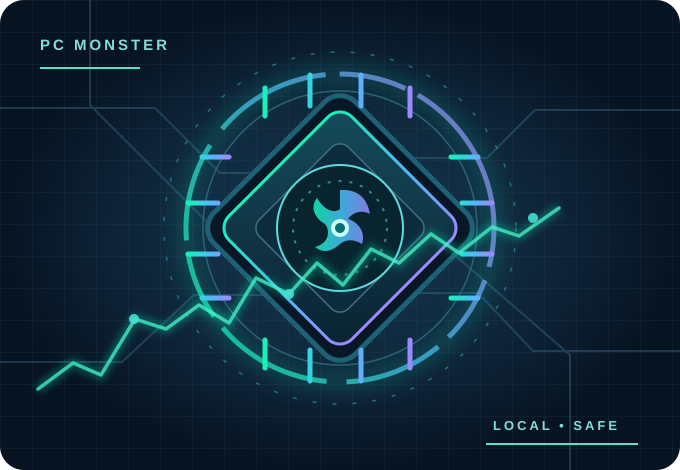

<!-- DVILR PROJECT COVER v1 -->
<p align="center"></p>
<p align="center"><a href="https://github.com/dvilrgamerz">DVILR on GitHub</a> · <a href="https://github.com/dvilrgamerz/PC-Laptop-Doctor-AI/issues">Report an issue</a></p>
<!-- /DVILR PROJECT COVER -->

# PC & Laptop Doctor AI — PC Monster

**Version: v9.0.0-beta.3 | Windows 10/11 x64 | Public tester beta (unsigned)**

PC Monster is an actual Windows Electron desktop app, not a browser-only mockup. It measures CPU, RAM, GPU, battery, storage, temperature (when hardware reports it) and gaming-relevant conditions. **Monster Mode** performs reviewed automation, and **V9 Background Boost** adds an opt-in process-scoped Windows EcoQoS session optimizer. No background applications are force-closed.

<p align="center">
  
  
</p>
<p align="center"><em>Original vector illustrations, not real performance benchmarks.</em></p>

## Download Windows app

**[Latest PC Monster public tester release](https://github.com/dvilrgamerz/PC-Laptop-Doctor-AI/releases/tag/v9.0.0-beta.3)**

- **[Setup EXE (Windows x64)](https://github.com/dvilrgamerz/PC-Laptop-Doctor-AI/releases/download/v9.0.0-beta.3/PC-Laptop-Doctor-AI-Setup-9.0.0-beta.3-x64.exe)** — guided install, Start menu shortcuts, uninstall.
- **[Portable EXE (Windows x64)](https://github.com/dvilrgamerz/PC-Laptop-Doctor-AI/releases/download/v9.0.0-beta.3/PC-Laptop-Doctor-AI-Portable-9.0.0-beta.3-x64.exe)** — run without installing.
- **[SHA-256 checksum list](https://github.com/dvilrgamerz/PC-Laptop-Doctor-AI/releases/download/v9.0.0-beta.3/SHA256SUMS.txt)** — verify installer integrity before sharing.

These links become available only when the tagged Windows GitHub Actions release build succeeds. Until beta.3 artifacts are verified, [v9.0.0-beta.2](https://github.com/dvilrgamerz/PC-Laptop-Doctor-AI/releases/tag/v9.0.0-beta.2) is the previous confirmed downloadable beta. **Do not share a version whose EXEs have not finished building.**

### V9 Beta.3 — event detection, real frame-time comparisons and manual graceful close

- **Native game-event notifications:** a separate read-only WMI watcher wakes game detection on process start and stop. Only the existing trusted Steam/Epic/manual path matching can activate Auto-Boost; the 5-second polling fallback remains if the watcher cannot start.
- **Real benchmark comparison:** import two local Intel PresentMon CSV captures through Windows file selection—one with Monster Mode off and another on. PC Doctor computes average presented FPS, 1%/0.1% lows, 95th/99th-percentile frame time and sample counts for one game process/swap chain. A single A/B pair does **not** prove causality; repeat A/B/A/B with the same route and settings. The app does not yet launch PresentMon or record frame traces itself. No CSV contents are uploaded.
- **Manual graceful close, never automatic:** during a trusted game, an eligible app may be selected for an **explicit confirmation dialog**. The helper re-verifies its executable and creation time, excludes services, Windows/security/game processes, requires exactly one visible main window and posts Windows `WM_CLOSE`. It does **not** force-terminate or guarantee the app exits. It cannot guarantee unsaved data preservation and does not automatically reopen closed apps. Save work before approving.
- **Not done:** safe unattended closing/reopening of third-party apps, reliable unsaved-data detection, automatic thermal/power rollbacks based on OEM-specific limits, signed release binaries, multi-PC/anti-cheat certification and guaranteed FPS improvement.

### V9 Game Session Engine — beta.2 native helper and recovery

Beta.2 replaces the per-process PowerShell/C# EcoQoS bridge with a locally compiled, **non-elevated Windows C++ helper**. Its fixed commands are limited to inspection, reduction, restoration and lifetime probing. The helper verifies the target's executable and process creation time and independently blocks Windows service processes, cross-session processes, known game launcher, anti-cheat, security and Windows components. A rejected operation leaves the target unchanged. Microsoft documents the [GetProcessInformation](https://learn.microsoft.com/en-us/windows/win32/api/processthreadsapi/nf-processthreadsapi-getprocessinformation) and [SetProcessInformation](https://learn.microsoft.com/en-us/windows/win32/api/processthreadsapi/nf-processthreadsapi-setprocessinformation) APIs used.

Monster Mode also offers an **optional AC-only High Performance power profile**, OFF by default and bound to the short-lived approval preview. On battery or if the plan is unsupported, Game Focus skips the power change. The previous plan is restored on game exit or recovery; more fan noise, heat and energy use are possible. There is not yet thermal-throttling-aware automatic power rollback.

The journal now records a unique session ID, durable written intent, and separate **confirmed vs attempted** counts. Revoking consent during an active game requests immediate restoration. Protected/unverifiable processes are shown in a read-only explanation list without exposing their executable paths. The beta.2 detector introduced 5-second polling; beta.3 also adds a WMI event watcher with polling fallback.

**Caution:** A non-elevated helper is not the same as a digitally signed helper. The beta.2 installer and helper remain unsigned until a trusted signing certificate and independent QA are available. The build compiles the helper from the repository C++ source using MSVC; no prebuilt binary is downloaded.

### V9 Game Session Engine — first beta implementation

**Implemented:** verified game detection, one-time per-executable approval of `Reduce during games`, automatic reversible EcoQoS requests for up to four approved eligible running processes when a trusted game starts, disk-backed write-ahead state, process executable/creation-time verification, automatic restoration on game exit, startup and quit, and a visible `Restore original QoS` control. Microsoft documents the [Windows process power-throttling API](https://learn.microsoft.com/en-us/windows/win32/api/processthreadsapi/nf-processthreadsapi-setprocessinformation).

**Important restrictions:** unknown, unverified, Windows system, anti-cheat, security, launcher, game, and PC Doctor processes are kept by default. Only exact executable identities that you select in the desktop UI can be reduced. The helper does not force terminate or suspend apps, disable services, edit registry keys, elevate Electron or alter your files. Windows 10 and older Windows 11 builds may not support reading the prior EcoQoS state; those processes must be skipped safely rather than changed without a reversible snapshot. Some third-party apps will also deny access. No 2×–10× performance or guaranteed FPS benefit is claimed.

**Not implemented:** automatic closing/relaunch, one-click PresentMon capture, signed installer/native helper, verified thermal control, multi-device Windows validation, or game-specific graphics presets. See [V9 implementation and test gates](docs/V9_GAME_SESSION_BETA_TEST_PLAN.md).

### Do this once; then let supported automation run

1. Download the real Windows EXE, launch it and check the **Dashboard**. Diagnostics start automatically and are read-only.
2. In **PC Monster**, choose whether to start the app automatically when you sign into Windows (packaged Windows edition only).
3. Select **Power up Monster Mode**, review the exact changes and click **Approve and automate**.
4. Optionally select **Inspect running applications** in **V9 Background Boost** and approve **Reduce during games** for each eligible user app. Those opt-ins are saved locally. This does not close the apps or modify them immediately.
5. Once enabled, PC Doctor watches verified Steam/Epic or personally added game processes. During supported games, it can temporarily manage Windows Game Mode and request EcoQoS for only your eligible, approved apps. After the game, it attempts restoration. Weekly old-Temp recycling remains separate. **The app must be running**; start-with-Windows helps.
6. Check the live status tiles for startup setting, active game, last cleanup date and number of files recycled. **Turn off automation** disables both modes and attempts to remove its own startup registration.

No repetitive Windows Settings instructions are required for the supported Monster Mode actions. Some activities (driver updates, deleting personal downloads, uninstalling programs, modifying hardware, elevated or risky system changes) deliberately remain outside automatic care.

## What the app actually does

| Area | Implementation | Limitation |
| --- | --- | --- |
| PC dashboard | Read-only live resource and diagnostic snapshots, heuristic warnings | Missing sensors show unknown; a score is not a medical-grade hardware diagnosis |
| Monster Mode | Explicit approval for trusted-game Auto-Boost and weekly recoverable Temp cleanup | Requires app running and verified game process; does not promise more FPS |
| V9 Background Boost | Per-executable, opt-in EcoQoS during trusted game sessions, with lifetime verification and durable restore journal | Does not close apps; older Windows builds or protected processes may be unsupported; Windows physical QA pending |
| Sign-in automation | Opt-in, reversible Windows launch-at-login registration | Works in packaged Windows build only; keep the Portable EXE in its original location after enabling; Windows startup preferences can override it |
| Game Focus | Temporarily manages available Windows Game Mode; power profile is a separate, reviewed option | Respects unsupported settings and recovery; no arbitrary process closing |
| Safe Care | In-app review and execution for PC Doctor HTTP cache and eligible old user-Temp files | Recycle Bin moves do **not** immediately free disk space |
| Storage / games | Find candidates; detected Steam/Epic launchers; optional user-selected game EXEs | No game-file, anti-cheat or registry-cleaner hacks |
| AI assistance | Offline/local explanatory features and optional local model integration | Not an always-correct model; does not repair unknown hardware faults |
| Benchmarks | Comparison and reporting tools | No independent Razer Cortex/Hone.gg performance victory has been demonstrated |

**Not included:** hidden termination of apps, forced deletion of documents/Downloads, stopping Windows Defender, disabling updates, registry sweeping, overclocking, fake RAM expansion or guaranteed FPS gains. A real laptop cannot exceed its CPU, RAM, GPU, thermal or power limits through a software button.

## Safety and privacy

- Off by default for mutating background automation; explicit reviewed approval precedes enabling it.
- Limited old top-level user Temp `.tmp` files are recycled, with age and path checks. Nothing in personal folders is silently deleted.
- Game preferences and V9 Background Boost have independent local undo journals; failed reversals are reported, not silently called successful.
- System readings are processed locally. A requested network check may contact a public ping endpoint; this is not an uploaded scan report.
- No purchased subscription, account, or remote server is required for local diagnostics.
- **Unsigned beta.** Building the EXE in CI is not equivalent to a Windows certification, code-signing validation, malware audit, or multi-device QA. Only share releases after checking the GitHub workflow and SHA-256 sums.

## Test with friends

See [Friend testing checklist](docs/FRIEND_TESTING.md) and [V8.2 beta.4 test gates](docs/V8_2_BETA4_TEST_PLAN.md). Start with a noncritical Windows 10/11 PC, check first launch and uninstall, then test startup opt-in and disable, a trusted Steam/Epic or custom game, recovery after closing a game, and Temp recycling with deliberately created old disposable test files. Test low-RAM/low-storage and offline cases. Submit reproducible problems at [GitHub Issues](https://github.com/dvilrgamerz/PC-Laptop-Doctor-AI/issues).

**Release status:** suitable for informed opt-in testers after artifacts are published; **not** independently validated or code signed for broad, unattended public deployment.

## Development

Building the Windows installer requires **Visual Studio C++ x64 Build Tools** so the helper can be compiled locally. The release workflow compiles and tests it on a Windows runner before packaging.

```bash
npm install
npm test
npm run build
npm run dev
```

For Windows setup/portable installers on Windows: `npm run dist:win`. GitHub Actions runs automated tests and builds both `.exe` types; inspect [Actions](https://github.com/dvilrgamerz/PC-Laptop-Doctor-AI/actions) and [Releases](https://github.com/dvilrgamerz/PC-Laptop-Doctor-AI/releases) before distribution. The web build is a clearly labeled **sample-data demo**: it cannot change the viewer's PC.

GitHub Pages auto-deployment is opt-in because repository Pages is not currently configured: first select **Settings → Pages → Build and deployment → GitHub Actions**, then set the repository Actions variable `DVILR_ENABLE_PAGES=true`. A red Pages workflow does not mean the Windows desktop build failed.

## Documentation

- [Security and limitations](SECURITY.md)
- [Tester release notes](RELEASE_NOTES.md)
- [Testing procedures](docs/TESTING.md)
- [Release history and roadmap](docs/ROADMAP.md)
- [Competitive research](docs/COMPETITIVE_RESEARCH.md)

**Licensing note:** There is currently no `LICENSE` file. The source is publicly viewable but should not be described as open source under a specific license until the project owner selects one. Do not assume redistribution/derivative rights from a public repository alone.
